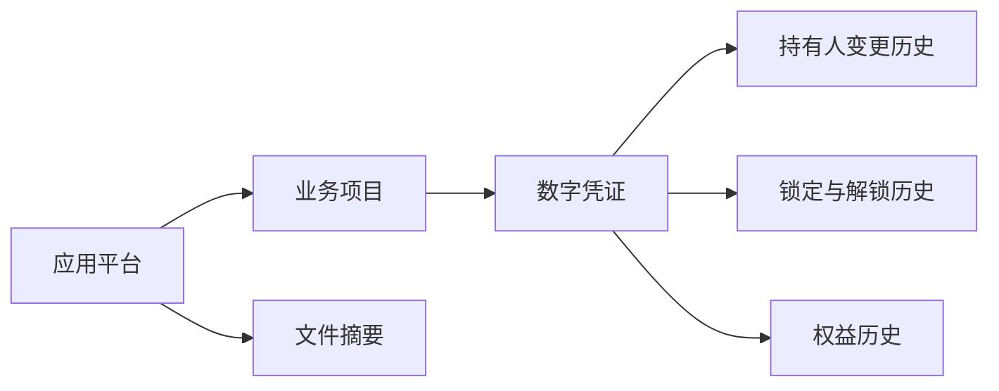

# TCT 全流程溯源合约

TCT 是面向 EVM 的业务生命周期记录合约，通过平台、项目和数字凭证建立对象关联，记录持有人变更、锁定与解锁、权益及文件摘要，为业务系统提供可查询的追溯依据。

本仓库提供 Solidity 合约、Hardhat 测试、部署与演示脚本，以及接口和接入文档。当前版本基于交易数字凭证登记原型整理，适合研究、集成验证和场景扩展。具体追溯范围取决于应用提交的业务数据。

## 核心能力

| 能力 | 实现方式 |
| --- | --- |
| 对象标识 | 自动分配平台、项目、凭证和文件 ID，维护平台与项目、项目与凭证的归属关系 |
| 项目与凭证登记 | 登记名称、主体、数量、状态及扩展信息，支持更新当前状态 |
| 持有人变更 | 记录来源、接收方、数量、扩展信息和区块时间，并累计持有人数量 |
| 锁定与解锁记录 | 按持有人追加业务记录，供应用还原锁定过程 |
| 权益记录 | 记录申报持有数量、权益数量与扩展信息，事件附带写入时的实际累计数量 |
| 文件摘要登记 | 记录平台下的文件名称、32 字节摘要及扩展信息，支持更新 |
| 追溯查询 | 提供当前状态、关系索引、持有人变更历史、锁定历史和权益历史查询 |
| 写入权限 | 平台 owner 管理所属业务对象；全局 admin 可转移平台 owner |



文件直接归属平台；与项目或凭证的关联由应用在 `metadata` 中约定，合约不校验该关联。

## 实现边界

- **平台提交业务记录。** 持有人是字符串标识，未绑定钱包；持有人无需签名，业务写入由所属平台 owner 执行。
- **数量为业务记账值。** `Credential.count` 与累计持有数量独立，未实施总量约束；持有人数量使用 `int256`，允许负数。
- **锁定是记录。** 锁定/解锁不限制后续变更、不修改持有人数量，也不校验净锁定量。
- **权益是记录。** 不自动计算权益、不转账或结算，不要求申报持有数量等于当前累计数量。
- **历史查询分为两类。** 持有人变更、锁定与权益有链上历史数组；项目、凭证和文件查询返回当前值，更新过程需结合交易与事件追溯。
- **格式由接入方约定。** `metadata` 建议使用 JSON，但合约不校验 JSON、身份、业务状态、文件内容或摘要算法。
- **平台隔离体现为写入权限。** 查询接口公开，不提供平台间数据保密；全局 admin 可以更换平台 owner。当前没有暂停、升级代理或持有人撤销授权机制。

TCT 不实现 ERC-20 / ERC-721 / ERC-1155 接口，也未在本仓库实现与身份合约、独立存证合约的自动互调。仓库不附带前端、文件存储服务或事件索引服务。

## 快速开始

编译配置为 Solidity `0.8.24`，启用优化器（200 runs）和 `viaIR`。使用 Hardhat 2 与 ethers 6 工具链。锁文件保留原型解析的依赖版本；运行环境需满足实际安装版本的 Node.js 要求。

```bash
git clone https://github.com/lbio-cc/tct.git
cd tct
pnpm install --frozen-lockfile
pnpm compile
pnpm test
pnpm demo
```

`pnpm demo` 在临时本地 Hardhat 网络中部署合约，依次演示登记、分配、变更、锁定/解锁、权益记录和文件摘要查询，结束后网络状态不保留。演示中的名称、机构、持有人及文件内容均为虚构数据。

需要保留本地节点会话中的状态时，先运行：

```bash
pnpm node
```

另开终端部署至该节点：

```bash
pnpm deploy:local
```

部署不需要构造参数，部署地址成为初始 `admin`。默认脚本只使用 Hardhat 本地账户，不包含公网 RPC、私钥或已部署地址。首次编译可能需要下载指定版本的 Solidity 编译器。

## 目录

```text
contracts/TCT.sol          合约源码
test/TCT.test.js           从原型整理的功能与权限测试
test/TCT.lifecycle.test.js 生命周期示例及关键行为边界测试
scripts/deploy.js          部署脚本
scripts/demo.js            本地业务演示
docs/API.md               写入、读取与事件说明
docs/DESIGN.md            数据模型、权限及追溯语义
docs/INTEGRATION.md       接入约定、摘要核验与事件同步
hardhat.config.js         编译配置
pnpm-lock.yaml            依赖锁文件
```

## 文档与测试

- [数据模型与设计](docs/DESIGN.md)
- [合约接口](docs/API.md)
- [接入指南](docs/INTEGRATION.md)

测试涵盖管理员与平台 owner 权限、项目/凭证登记与更新、持有人变更及负数记账、锁定历史、权益历史和文件摘要更新，并用虚构数据串联生命周期。测试源码随仓库提供；是否通过应以对应环境实际执行结果为准。仓库不附带独立安全审计报告。

## 参与贡献

可通过 Issue 说明使用场景或复现问题，通过 Pull Request 提交改进。修改合约时请同步更新相关测试和文档，说明是否改变 ABI、权限、数量含义或历史记录语义。请勿在提交中包含私钥、RPC 凭据或真实业务敏感信息。

## 许可证

本项目采用 [MIT License](LICENSE)。
